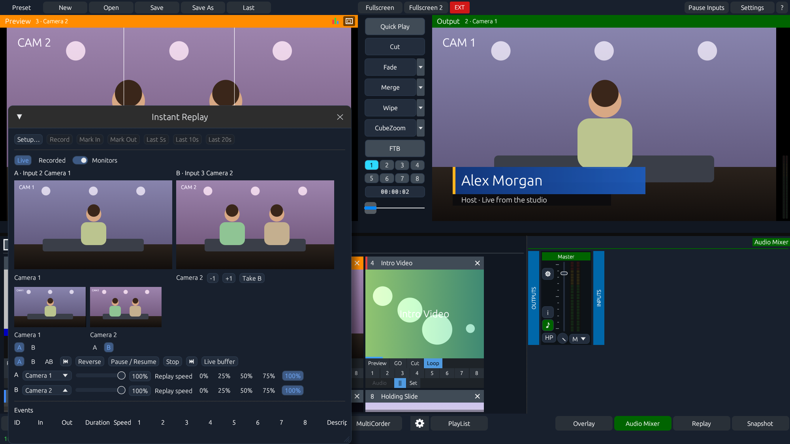
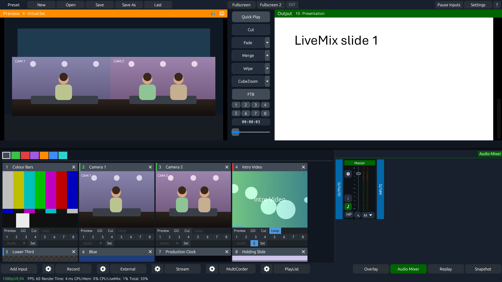

# LiveMix

LiveMix is a Rust live video production switcher for Windows and Apple Silicon Macs. It combines camera feeds, clips, desktop capture, network video, graphics and stereo audio in a Preview and Program workflow. Operators can prepare a shot in Preview, switch it to Program, and send independently routed feeds to local displays, recorders and network receivers. The egui interface offers Classic and Modern themes.

## Start here

Test builds for Windows x64 and Apple Silicon are published under [GitHub Releases](https://github.com/mrbocao/livemix/releases). See the setup guide below for FFmpeg, device runtimes and platform requirements.

| Guide | What it covers |
| --- | --- |
| [Setup and dependencies](docs/SETUP.md) | Windows and Mac builds, FFmpeg, NDI, OMT, DeckLink, permissions and GPU setup |
| [Operator guide](docs/OPERATOR.md) | Switching, audio, recording, streaming, replay, telestration and automation |
| [Changes](CHANGELOG.md) | Implemented changes and the conditions under which they work |
| [Roadmap](docs/ROADMAP.md) | Open work, hardware validation and performance priorities |
| [Agent guide](AGENTS.md) | Source map, test commands, safety of project state and contribution workflow |

## What it does

- **Switch and compose.** Use Cut, timed transitions, T-bar, GT stingers, eight overlay channels, layered inputs, position, crop, chroma key, luma key, 3D LUTs and colour adjustments. Monitor the picture with waveform, RGB parade, vectorscope and safe areas.
- **Mix stereo audio.** Capture and monitor 48 kHz audio, route it through Master, A and B, and apply per-input EQ, gate, compression, gain and delay.
- **Record and distribute.** Route four independent outputs to local windows, DeckLink, NDI, OMT or SRT as supported. Record two configured routes or use MultiCorder. Compatible RTMP destinations can share an encoder.
- **Operate a show.** Mark events from up to eight Replay angles and cue the A/B players independently. The recorder indexes captured frames per angle. Use the Telestrator, keyboard and MIDI controls, local web switcher, scripts and VISCA over UDP.
- **Build studio scenes.** Capture a web page as an input or add a static PowerPoint or LibreOffice deck with manual slide navigation. Build a Virtual Set with backdrop, presenter and foreground layers, then switch between animated camera views.
- **Move projects between sessions.** Save and reopen LiveMix project presets. The import report lists missing media and unsupported input types. Compatibility with third-party presets and GT templates is partial.

## Screenshots

| Scopes | Replay |
| --- | --- |
|  |  |

## Contribute

Operators can help validate DeckLink and network video on real hardware, check Replay sync across cameras or record a 30-minute A/V test. Developers can take on browser inputs, GPU readback reduction, or a reproducible GT fixture. See [Contributing](CONTRIBUTING.md) and the [roadmap](docs/ROADMAP.md) for starting points.

## Translations

Choose the interface language in **Settings → Options**. See the [translation guide](app/locales/README.md) to contribute another language.

## Project status

LiveMix is in alpha. Windows can keep compatible decoded clips and eligible hardware recording surfaces on the GPU when OpenGL and D3D11 use the same adapter. Other configurations may use system memory. Apple Silicon has a separate build and media backend. Consult the [roadmap](docs/ROADMAP.md) for the hardware and workflow combinations that still need testing.

The [screenshots](docs/screenshots) show the Windows interface with demo sources. Report bugs with the operating system, GPU and driver, input type, project format, output route and steps to reproduce. [Open an issue](https://github.com/mrbocao/livemix/issues)

Third-party DSP and VISCA code is covered by the [MIT notice](docs/THIRD-PARTY-MIT.txt).
