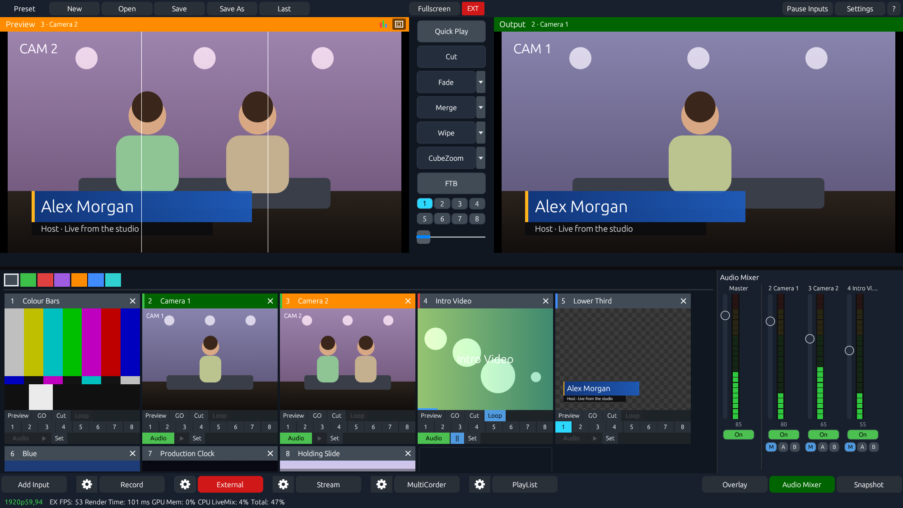
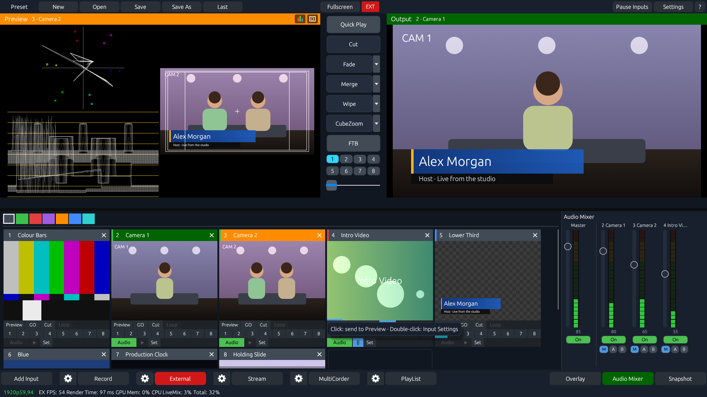
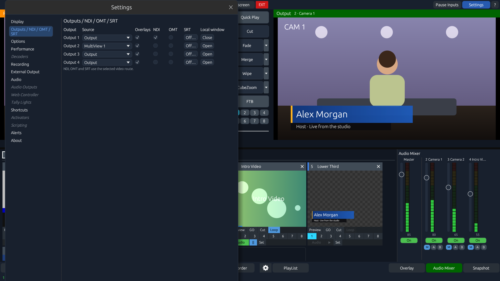
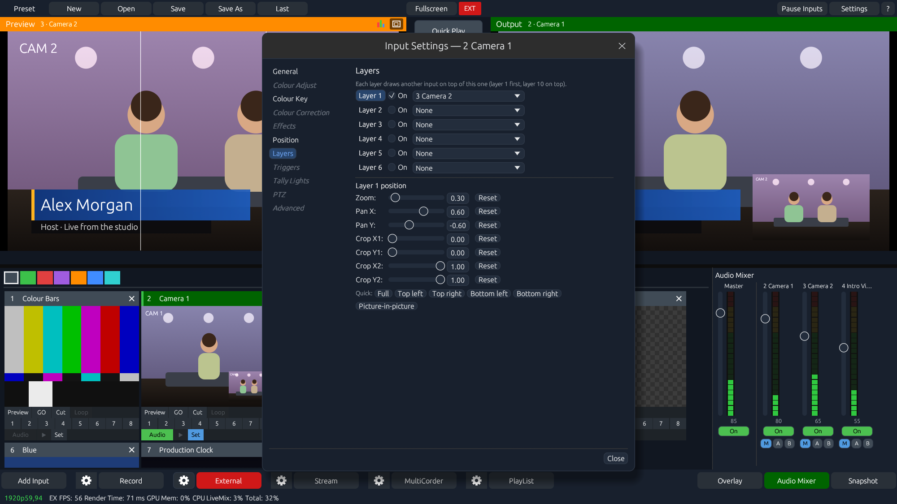

# LiveMix

[](https://github.com/mrbocao/livemix/actions/workflows/rust.yml)

LiveMix is an experimental live video production switcher built in Rust. It brings cameras, clips, desktop capture, graphics, and network feeds into a familiar Preview and Program workflow for live events and studio productions. The interface uses egui and offers Classic and Modern themes.



## What you can do

- Switch live sources with Cut, timed transitions, a manual T-bar, GT stingers, and eight overlay channels. Open a larger preview from any input card.
- Build scenes with picture-in-picture layers, crop, position, and chroma key. Load supported GT Designer `.gtzip` titles, edit text fields, and use template clocks.
- Check the picture with safe areas, waveform, RGB parade, and vectorscope. The status bar reports the measured project cadence separately from interface repaints.
- Route Program, Preview, MultiView, or an input to four independent outputs. Use local output windows, NDI, OMT, SRT, or supported DeckLink devices.
- Record two configurable video outputs, record selected sources with MultiCorder, and stream RTMP/RTMPS through FFmpeg. Save projects as `.vmix` presets for the supported input types.

## Screenshots

The captures show the Windows build with its built-in demo sources.

| Video scopes | Network routing | Input layers |
| --- | --- | --- |
| [](docs/screenshots/video-scopes.png) | [](docs/screenshots/network-outputs.png) | [](docs/screenshots/input-layers.png) |

## Build on Windows

Install stable Rust and the Visual Studio Build Tools with the Desktop development with C++ workload. From the repository root, run:

```powershell
cd app
cargo run --locked --release
cargo test --locked --release -- --skip first_camera_delivers_frames
```

The desktop capture test needs an interactive Windows session. The camera test also needs a physical camera. The standard GitHub Actions job skips both.

## Network and capture dependencies

| Feature | Setup |
| --- | --- |
| RTMP/RTMPS and SRT | Use FFmpeg. Put `ffmpeg.exe` next to LiveMix or set `LIVEMIX_FFMPEG` to its full path. Verify SRT is listed by `ffmpeg -protocols`. SRT supports Caller and Listener with H.264 or HEVC. |
| NDI | Install a 64-bit NDI runtime or NDI Tools. |
| OMT | Place `libomt.dll` and `libvmx.dll` next to LiveMix or set `LIVEMIX_OMT_DIR` to their folder. [OMT SDK releases](https://github.com/openmediatransport/libomtnet/releases) |
| DeckLink | Install Blackmagic Desktop Video and use **Blackmagic** in **Add Input** or configure a device under **External Output**. Hardware verification is still needed. |

Discover LAN sources under **Add Input → NDI / OMT / Desktop Capture**, or choose **Stream / SRT** for an SRT input. Configure publishing under **Settings → Outputs / NDI / OMT / SRT**. To run local network checks with the runtimes installed, use `cargo test --locked --release loopback -- --ignored` from `app`.

## Current limits

LiveMix is in alpha. Audio controls and meters are still experimental. RTMP and SRT send silent AAC, NDI and OMT carry video, and recording is video-only. GT templates and vMix presets support a subset of their respective features. Sustained network frame rates depend on the source, encoder, machine, and receiver.

## Contribute

The project welcomes focused fixes and reproducible reports, especially around GPU readback, sustained network output, audio mixing, and capture hardware. Include the operating system, GPU and driver, input types, project format, and steps to reproduce. For performance reports, include the measured project FPS and receiver FPS separately when available. [Open an issue](https://github.com/mrbocao/livemix/issues)
